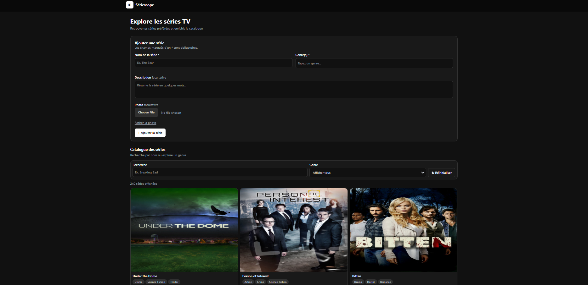

# SériesScope

Catalogue en ligne de séries TV : une application web sur une seule page qui permet de parcourir, rechercher, filtrer et ajouter des séries.

Projet réalisé dans le cadre du brief **SérieScope — Catalogue de séries (1/2)** à YouCode Youssoufia (Classe 4 A1 2026/2027).

## Liens du projet

| Ressource | Lien |
| --- | --- |
| Site en ligne (GitHub Pages) | https://abdessamad-amimi.github.io/SerieScope/index.html |
| Tableau Jira | https://abdessamadamimi99.atlassian.net/jira/software/projects/SC/boards/69?filter=&groupBy=none |
| Dépôt GitHub | https://github.com/abdessamad-amimi/SerieScope |
| Maquette Figma | https://www.figma.com/design/4CmBLmIxwXwj9K8xu9O6Gu/S%C3%A9riescope-%E2%80%94-Brief-1-du-Sprint-3?node-id=3-7&t=2UJoXDZG8P8mjUaK-0 |

## Aperçu



## Fonctionnalités

- Affichage du catalogue sous forme de cartes (titre, affiche, genres, description).
- Récupération des 20 premières séries depuis l'API TVmaze avec `fetch()`.
- Messages de chargement et d'erreur, avec des valeurs de remplacement quand une information manque (par exemple une affiche absente).
- Recherche par nom, sans tenir compte des majuscules et minuscules.
- Filtre par genre, construit à partir des genres présents dans le catalogue, avec l'option « Tous les genres ».
- Bouton de réinitialisation qui rétablit le catalogue complet.
- Message « Aucune série trouvée » quand aucun résultat ne correspond.
- Ajout d'une série via un formulaire validé (nom obligatoire, au moins un genre, description et photo facultatives).
- Page de détails d'une série (nom, image, genres, description, site officiel).
- Interface responsive : desktop, tablette et mobile.

## API utilisée

Les données du catalogue viennent de l'[API TVmaze](https://www.tvmaze.com/api) (gratuite, sans clé) :

```
GET https://api.tvmaze.com/shows?page=0
```

Propriétés exploitées : `name`, `language`, `status`, `genres`, `image.medium`, `summary`, `officialSite`.

## Technologies

- HTML5 sémantique
- [Tailwind CSS](https://tailwindcss.com/)
- JavaScript Vanilla (modules ES, `async/await`, `fetch`)
- Git / GitHub (GitFlow) et Jira

## Structure du projet

```
SérieScope/
├── assets/              # Images et ressources
├── css/
│   └── output.css       # CSS généré par Tailwind
├── js/
│   ├── models/
│   │   ├── Series.js         # Modèle d'une série
│   │   └── SeriesManager.js  # Gestion de la liste, recherche et filtres
│   ├── view/
│   │   └── SeriesView.js     # Affichage et événements de la page d'accueil
│   └── Details.js            # Logique de la page de détails
├── src/
│   └── input.css        # Source Tailwind
├── index.html           # Page d'accueil (catalogue, filtre, formulaire)
├── details.html         # Page de détails d'une série
├── package.json
└── README.md
```

## Lancer le projet

### Prérequis

- [Node.js](https://nodejs.org/) installé
- Un navigateur récent
- Un serveur local (par exemple l'extension **Live Server** de VS Code), car le projet utilise des modules JavaScript

### Installation

```bash
# 1. Cloner le dépôt
git clone <url-du-depot>
cd <nom-du-dossier>

# 2. Installer les dépendances
npm install

# 3. Générer le CSS Tailwind (en continu pendant le développement)
npx @tailwindcss/cli -i ./src/input.css -o ./css/output.css --watch
```

> Si le `package.json` contient déjà un script pour Tailwind, utilise-le à la place (par exemple `npm run dev`).

Ouvre ensuite `index.html` avec Live Server.

## Organisation du travail (GitFlow)

- Branches principales : `main` (production) et `develop` (intégration).
- Branches de fonctionnalités : `feat/HTML&Tailwind`, `feat/Afficher`, `feat/RechercheFiltrage`, `feat/Ajouter`, ...
- Suivi des tâches dans Jira avec les statuts : À faire, En cours, En revue, Terminé.

## Auteur

**Abdessamad Amimi** — YouCode Youssoufia, Classe 4 A1 2026/2027